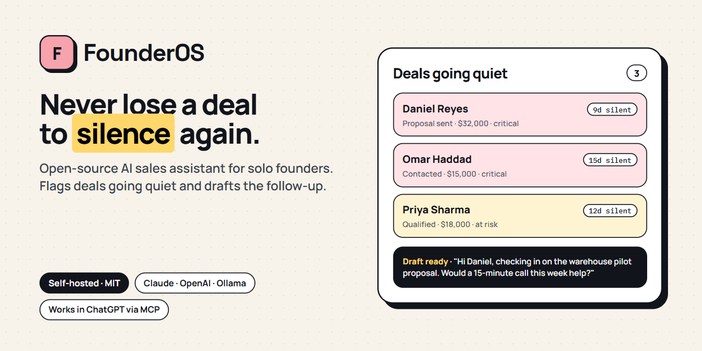
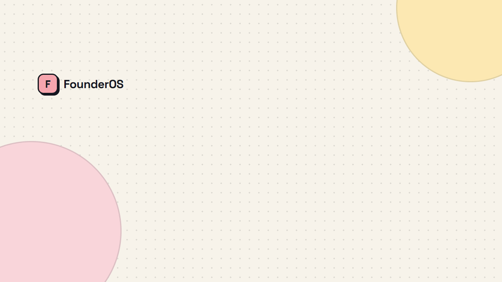
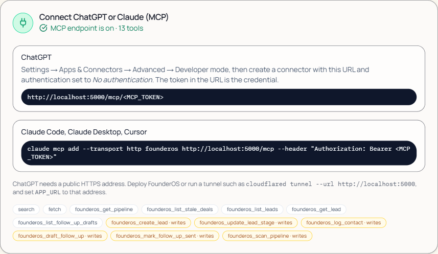

<p align="center">
  
</p>

# FounderOS: open-source AI sales assistant for solo founders

<p>
  <a href="https://github.com/rahulsinghnegiii/Founder-OS/actions/workflows/ci.yml"></a>
  <a href="https://github.com/rahulsinghnegiii/Founder-OS/releases"></a>
  <a href="LICENSE"></a>
  <a href="#connect-chatgpt-or-claude-mcp"></a>
  <a href="#quick-start"></a>
  <a href="CONTRIBUTING.md"></a>
</p>

**FounderOS watches your sales pipeline, flags the deals that have gone quiet, and drafts the follow-up email for you to send.** Founders rarely lose deals to competitors. They lose them to silence: a proposal nobody chased, a warm lead nobody emailed back. FounderOS makes sure every open deal gets its next touch.

It is a self-hosted, open-source alternative to a full CRM like HubSpot or Pipedrive, built for one-person companies. It runs on your own Postgres, uses the AI provider you already pay for (Claude, OpenAI, OpenRouter, Groq, or a free local model through Ollama), and plugs into ChatGPT and Claude as an MCP server.

**Built for** solo founders, indie hackers, freelancers, consultants, and small agencies who sell but do not want to maintain a CRM.

[Quick start](#quick-start) · [Features](#features) · [Use it from ChatGPT or Claude](#connect-chatgpt-or-claude-mcp) · [FAQ](#faq) · [Roadmap](#roadmap)



## Features

- **Stale-deal detection.** Every open lead has a silence allowance based on its stage: 3 days for new, 5 for contacted, 7 for qualified, 4 after a proposal. The Sales agent scans on boot and every six hours, flags anything past its limit, and marks it critical at double the limit.
- **AI follow-up drafts.** Each quiet deal gets a short, human email written from the lead's notes, stage, and any proposal you sent. Copy it, send it from your own inbox, click "Mark sent", and the silence clock resets.
- **Lead scoring.** New leads are scored 0 to 100 so the pipeline sorts itself. A heuristic takes over when no AI is available.
- **Proposal follow-through.** Marking a proposal as sent moves the lead, records the contact, creates a follow-up task due in three days, and notifies you.
- **Daily pipeline brief.** Open value, value at risk, three concrete moves for today, and the risks, refreshed hourly.
- **Chat with your pipeline.** Ask "which deals are going quiet?" or "draft a follow-up for Priya" and the Sales agent answers from live data. It also captures leads, tasks, and projects from plain sentences.
- **Works inside ChatGPT and Claude.** A built-in [MCP](https://modelcontextprotocol.io) server lets ChatGPT, Claude, Cursor, or any MCP client read your pipeline and act on it.
- **Bring your own AI.** Anthropic Claude, OpenAI, OpenRouter, Groq, or Ollama. With no AI key at all, it still runs with template drafts and rule-based briefs.
- **Private by default.** Your data stays in your own database. One password protects the app, and AI keys never reach the browser.

## How it compares

| | FounderOS | A typical hosted CRM |
| --- | --- | --- |
| Notices when a deal goes quiet | Automatically, per stage | You build a report or remember |
| Writes the follow-up email | Yes, from the deal's context | Templates you fill in |
| Where your data lives | Your Postgres | The vendor's cloud |
| Price | Free and MIT licensed; you pay only your AI provider, or nothing with Ollama | Usually per seat, per month |
| Works from ChatGPT or Claude | Yes, via MCP | Varies |
| Setup | One `docker compose up` | Account, onboarding, field setup |

FounderOS is deliberately small. If you need team permissions, marketing automation, or a hundred integrations, a full CRM is the better tool.

## Quick start

### Docker Compose (recommended)

```bash
git clone https://github.com/rahulsinghnegiii/Founder-OS.git founderos && cd founderos
cp .env.example .env
# Edit .env: set APP_PASSWORD and ONE AI key (ANTHROPIC_API_KEY is the default choice).
docker compose up --build
```

Open http://localhost:5000. Add `SEED_DEMO=1` to `.env` before the first start if you want a sample pipeline to click around in.

### Local development

Requirements: Node 24, pnpm 10, and a Postgres you can reach.

```bash
pnpm install
cp .env.example .env            # set DATABASE_URL and one AI key
pnpm run db:push                # apply the schema
pnpm run seed:demo              # or `pnpm run seed` for an empty workspace
pnpm run dev:api                # terminal 1, API on :5001
pnpm run dev:web                # terminal 2, app on :5000
```

No Postgres handy? Start one in Docker and point `DATABASE_URL` at it:

```bash
docker run -d --name founderos-db -e POSTGRES_USER=founderos -e POSTGRES_PASSWORD=founderos -e POSTGRES_DB=founderos -p 5432:5432 postgres:16-alpine
```

Windows note: in Git Bash, prefix commands with `MSYS_NO_PATHCONV=1` or `BASE_PATH=/` gets rewritten to a Windows path. PowerShell users can run `.\start.ps1`.

## Configuration

All configuration is environment variables. `.env.example` documents every one. The important ones:

| Variable | Purpose |
| --- | --- |
| `DATABASE_URL` | Postgres connection string. Required. |
| `APP_PASSWORD` | Protects the whole app behind one password. Leave empty only on your own machine. |
| `ANTHROPIC_API_KEY` | Recommended provider. Default model `claude-opus-5-5`; override with `ANTHROPIC_MODEL`. |
| `OPENAI_API_KEY`, `OPENROUTER_API_KEY`, `GROQ_API_KEY`, `OLLAMA_BASE_URL` | Alternative providers. The first configured one wins; `AI_PROVIDER` forces a choice. |
| `MCP_TOKEN` | Turns on the MCP endpoint for ChatGPT and Claude. Off when empty. |
| `FOUNDER_NAME` | Used in prompts and email sign-offs until a profile name is stored. |

Keys are read on the server only. Settings → AI Provider shows which provider is active and has a "Test connection" button.

## Connect ChatGPT or Claude (MCP)

FounderOS ships an [MCP](https://modelcontextprotocol.io) server at `/mcp`, so you can work your pipeline from the assistant you already use. Ask "which deals are going quiet?", "draft a follow-up for Priya", or "mark Daniel as won", and it calls FounderOS directly.

**1. Turn it on.** Generate a token, put it in `.env`, and restart. MCP stays off until the token is set.

```bash
node -e "console.log(require('crypto').randomBytes(24).toString('hex'))"
# .env
MCP_TOKEN=<the value printed above>
```

**2. Connect a client.**

| Client | How |
| --- | --- |
| ChatGPT | Settings → Apps & Connectors → Advanced → enable Developer mode, then create a connector. URL `https://<your-host>/mcp/<MCP_TOKEN>`, authentication "No authentication". The token in the URL is the credential. |
| Claude Code | `claude mcp add --transport http founderos https://<your-host>/mcp --header "Authorization: Bearer <MCP_TOKEN>"` |
| Claude Desktop, Cursor, others | Streamable HTTP at `https://<your-host>/mcp` with header `Authorization: Bearer <MCP_TOKEN>`. |

ChatGPT connects from OpenAI's servers, so it needs a public HTTPS address; `localhost` will not work. Deploy FounderOS, or run a tunnel such as `cloudflared tunnel --url http://localhost:5000`, and set `APP_URL` to that address so links in tool results point at it. Claude Code runs on your machine and can use `http://localhost:5001/mcp` directly. Which ChatGPT plans allow custom connectors and write actions changes over time, so check OpenAI's current documentation.

**Tools**

| Tool | Does |
| --- | --- |
| `search`, `fetch` | Find leads and proposals by text, then read the full record. The shape ChatGPT connectors expect. |
| `founderos_get_pipeline` | Stage totals, value at risk, drafts waiting, and the Sales agent's brief with today's moves. |
| `founderos_list_stale_deals` | Deals past their stage's silence limit, most urgent first. |
| `founderos_list_leads`, `founderos_get_lead` | Filter, sort, and page through leads; get one lead with proposals and follow-up history. Leads can be named instead of passing an id. |
| `founderos_list_follow_up_drafts` | Follow-up emails waiting to be sent. |
| `founderos_create_lead` | Add a lead. Refuses duplicates by email. |
| `founderos_update_lead_stage`, `founderos_log_contact` | Move a deal or record outreach, with an optional dated note. |
| `founderos_draft_follow_up`, `founderos_mark_follow_up_sent` | Have the Sales agent write an email, then record that you sent it. FounderOS never sends email itself. |
| `founderos_scan_pipeline` | Run the stale-deal scan now. |

Treat the connector URL like a password: anyone holding it can read and edit your pipeline. Rotate it by changing `MCP_TOKEN`. The token is redacted from request logs and never returned to the browser.



## FAQ

**Is FounderOS free?**
Yes. It is MIT licensed and self-hosted. You pay your AI provider for the drafts and briefs it writes, or nothing if you run a local model with Ollama.

**Does it send emails for me?**
No. It writes the draft and you send it from your own inbox, so nothing goes out without you reading it. Click "Mark sent" afterwards and the deal's silence clock resets.

**Which AI models does it support?**
Anthropic Claude (default `claude-opus-5-5`), OpenAI, any model on OpenRouter, Groq, and local models through Ollama. Set one key in `.env`.

**Can I use it without an AI key?**
Yes. Stale-deal detection, the pipeline, and scoring all work. Drafts fall back to templates and the brief to a rule-based summary.

**Where is my data stored?**
In your own Postgres. The only data that leaves your server is the context sent to the AI provider you configured. With Ollama, nothing leaves your machine.

**Can I use it from ChatGPT or Claude?**
Yes, through the built-in MCP server. See [Connect ChatGPT or Claude](#connect-chatgpt-or-claude-mcp).

**Does it sync with Gmail or import from another CRM?**
Not yet. Gmail sync is next on the [roadmap](#roadmap). Today you add leads in the app, by chat, or through MCP.

**Is it for teams?**
No. It is single-user by design, with one password. Teams are better served by a full CRM.

## Roadmap

- [x] Stale-deal detection with per-stage silence limits
- [x] AI follow-up drafts, lead scoring, proposal follow-through
- [x] Multi-provider AI: Claude, OpenAI, OpenRouter, Groq, Ollama
- [x] Docker Compose deployment and password protection
- [x] MCP server for ChatGPT, Claude, and Cursor
- [ ] Gmail sync: leads and last-contact dates fill themselves in
- [ ] Reply detection that resets the silence clock automatically
- [ ] Weekly pipeline email
- [ ] CSV import

Marketing, Operations, and Strategy departments are planned but deliberately parked until Sales is proven. See [docs/VISION.md](docs/VISION.md) for the longer arc.

## Architecture

pnpm monorepo, TypeScript end to end.

- `lib/api-spec/openapi.yaml` is the contract. Zod schemas (`lib/api-zod`) and React Query hooks (`lib/api-client-react`) are generated from it with Orval.
- `lib/db` is the Drizzle schema for Postgres.
- `artifacts/api-server` is an Express 5 API. The Sales agent lives in `src/services/sales-agent.ts` with its pure, tested rules in `src/services/sales-rules.ts`. The provider layer in `src/lib/ai` is the only place that talks to an AI vendor, and `src/mcp` is the MCP server.
- `artifacts/founder-os` is a React 19, Vite, and Tailwind app. The Sales Desk is `src/pages/sales.tsx`.

In production one process serves both the API and the built frontend. That is what the Docker image does.

## Development

The README demo is a [HyperFrames](https://hyperframes.heygen.com) composition in `videos/readme-demo`. After a UI change, re-render it from that folder with `npx hyperframes render --format gif --fps 15 -o ../../docs/demo.gif`.

```bash
pnpm run typecheck     # all packages
pnpm run test          # unit tests (node:test via tsx)
pnpm --filter @workspace/api-spec run codegen   # after editing openapi.yaml
```

## Contributing

Issues and pull requests are welcome, especially Gmail sync, reply detection, and deployment recipes. Read [CONTRIBUTING.md](CONTRIBUTING.md) first. Ask questions in [Discussions](https://github.com/rahulsinghnegiii/Founder-OS/discussions) and report security problems privately as described in [SECURITY.md](SECURITY.md).

If FounderOS saves you a deal, starring the repo helps other founders find it.

## License

[MIT](LICENSE) © Rahul Singh Negi
