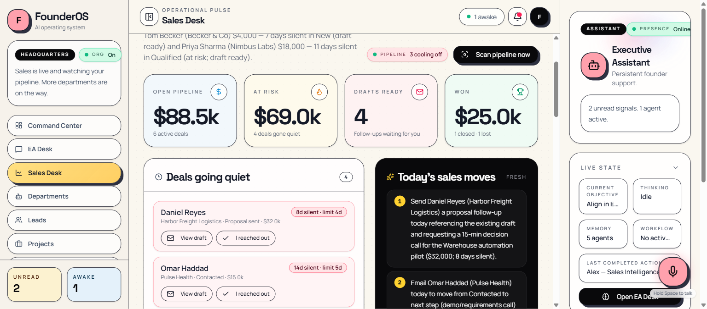

# FounderOS

**An AI sales assistant for solo founders.** It watches your pipeline, flags the deals that have gone quiet, drafts the follow-up email, and hands it to you to send. You stop losing revenue to forgotten replies.

FounderOS is self-hosted, runs on your own Postgres, and works with the AI provider you already pay for (Anthropic, OpenAI, OpenRouter, Groq, or a local Ollama model).



## What it does today

- **Stale-deal detection.** Every open lead has a silence allowance that depends on its stage (3 days for new, 5 for contacted, 7 for qualified, 4 after a proposal). The Sales agent scans on boot and every six hours and flags anything past its limit, escalating to "critical" at double the limit.
- **Follow-up drafting.** Each quiet deal gets a short, human email written from the lead's notes, stage, and any proposal you sent. Copy it, send it from your own inbox, click "Mark sent", and the silence clock resets.
- **Lead scoring.** New leads are scored 0 to 100 so the pipeline sorts itself. A heuristic takes over if the AI is unavailable.
- **Proposal follow-through.** Marking a proposal as sent moves the lead, sets last contact, creates a follow-up task due in three days, and notifies you.
- **Pipeline brief.** Open value, value at risk, three concrete moves for today, and risks, refreshed hourly and shown on the Command Center.
- **Executive Assistant chat.** Ask "which deals are going quiet?", "how is the pipeline?", or "draft a follow-up for Priya" and the Sales agent answers from live data. It also captures leads, tasks, and projects from plain sentences.

Everything degrades gracefully. With no AI key configured the app still runs, with template follow-ups and deterministic briefs.

## What it deliberately does not do yet

FounderOS ships one department at a time. Marketing, Operations, and Strategy appear as "coming soon" cards and never receive work. Reports, revenue, automations builder, notes, meetings, and team pages are parked behind a coming-soon screen. See [docs/VISION.md](docs/VISION.md) for where this is heading and [CONTRIBUTING.md](CONTRIBUTING.md) for what is welcome now.

## Five-minute setup

### Option A: Docker Compose (recommended)

```bash
git clone <this repo> founderos && cd founderos
cp .env.example .env
# Edit .env: set APP_PASSWORD and ONE AI key (ANTHROPIC_API_KEY is the default choice).
docker compose up --build
```

Open http://localhost:5000. Add `SEED_DEMO=1` to `.env` before the first start if you want a sample pipeline to click around in.

### Option B: Local development

Requirements: Node 24, pnpm 10, and a Postgres you can reach.

```bash
pnpm install
cp .env.example .env            # set DATABASE_URL and one AI key
pnpm run db:push                # apply the schema
pnpm run seed:demo              # or `pnpm run seed` for an empty workspace
pnpm run dev:api                # terminal 1, API on :5001
pnpm run dev:web                # terminal 2, app on :5000
```

No Postgres handy? Start one in Docker and point `DATABASE_URL` at it:

```bash
docker run -d --name founderos-db -e POSTGRES_USER=founderos -e POSTGRES_PASSWORD=founderos -e POSTGRES_DB=founderos -p 5432:5432 postgres:16-alpine
```

Windows note: in Git Bash, prefix commands with `MSYS_NO_PATHCONV=1` or `BASE_PATH=/` gets rewritten to a Windows path. PowerShell users can run `.\start.ps1`.

## Configuration

All configuration is environment variables. `.env.example` documents every one. The important ones:

| Variable | Purpose |
| --- | --- |
| `DATABASE_URL` | Postgres connection string. Required. |
| `APP_PASSWORD` | Protects the whole app behind one password. Leave empty only on your own machine. |
| `ANTHROPIC_API_KEY` | Recommended provider. Default model `claude-opus-5-5`; override with `ANTHROPIC_MODEL`. |
| `OPENAI_API_KEY`, `OPENROUTER_API_KEY`, `GROQ_API_KEY`, `OLLAMA_BASE_URL` | Alternative providers. The first configured one wins; `AI_PROVIDER` forces a choice. |
| `FOUNDER_NAME` | Used in prompts and email sign-offs until a profile name is stored. |

Keys are read on the server only. The browser never sees them. Settings → AI Provider shows which provider is active and has a "Test connection" button.

## Architecture

pnpm monorepo, TypeScript end to end.

- `lib/api-spec/openapi.yaml` is the contract. Zod schemas (`lib/api-zod`) and React Query hooks (`lib/api-client-react`) are generated from it with Orval.
- `lib/db` is the Drizzle schema for Postgres.
- `artifacts/api-server` is an Express 5 API. The Sales agent lives in `src/services/sales-agent.ts` with its pure, tested rules in `src/services/sales-rules.ts`. The provider layer in `src/lib/ai` is the only place that talks to an AI vendor.
- `artifacts/founder-os` is a React 19 + Vite + Tailwind app. The Sales Desk is `src/pages/sales.tsx`.

In production one process serves both: the API and, via `SERVE_STATIC_DIR`, the built frontend. That is what the Docker image does.

## Development

```bash
pnpm run typecheck     # all packages
pnpm run test          # unit tests (node:test via tsx)
pnpm --filter @workspace/api-spec run codegen   # after editing openapi.yaml
```

## Status and roadmap

This is an early, working prototype used by its author. Next up, in order: Gmail sync so leads and last-contact dates fill themselves in, reply detection, and a weekly pipeline email. Open an issue if you want to help with any of those.

## License

[MIT](LICENSE).
